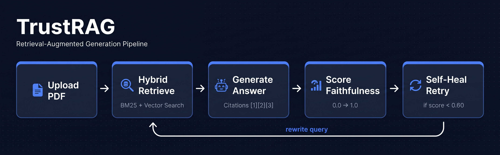

# TrustRAG — Cite · Score · Self-Heal

A full-stack RAG system that retrieves document chunks, generates cited answers, scores faithfulness, and automatically retries when answer quality is too low.


---

## Pipeline



---

## Chat Tab


---

## Self-Healing in Action


---

## Failure Mode Museum


---

## Run an Exhibit


---

## Features

| | Feature | What it does |
|---|---|---|
| 🔍 | Hybrid Retrieval | BM25 keyword search + vector cosine similarity, merged with weighted scoring |
| 📎 | Citation Grounding | Chunks labeled `[1][2][3]` in prompt — LLM cites them inline in the answer |
| 📊 | Faithfulness Scoring | Measures how grounded the answer is in retrieved chunks |
| ⚡ | Self-Healing Loop | If faithfulness < 0.60 → rewrites query → retries up to 2 times |
| 🏛️ | Failure Mode Museum | 5 exhibits with synthetic datasets triggering specific RAG failure patterns |
| 📄 | Live Failure Tracker | Logs last 5 real low-quality answers with auto-detected failure reason |

---

## Failure Mode Museum — 5 Exhibits

| Exhibit | Failure | Root Cause |
|---|---|---|
| ✂️ Split Sentence | Critical condition cut across two chunks | Chunking splits mid-sentence |
| 🌍 Out-of-Scope | AI answers from memory, not document | No in-scope chunks exist |
| 📅 Outdated Chunk | Old policy retrieved instead of new | Outdated chunk has better embedding similarity |
| ⚠️ Confident Wrong Answer | LLM generalizes what the doc never says | LLM fills gaps with plausible inference |
| 🔊 Noisy Retrieval | 5 chunks retrieved, only 1 is relevant | Broad query pulls unrelated sections |

---

## Quick Start

```bash
# Clone
git clone https://github.com/YOUR_USERNAME/trustrag.git
cd trustrag

# Backend
cd backend
pip install -r requirements.txt
echo "OPENAI_API_KEY=sk-..." > .env
uvicorn main:app --reload

# Frontend
cd ../frontend
npm install
npm run dev
```

Open `http://localhost:5173`, upload a PDF, start asking questions.

---

## Tech Stack

**Backend:** FastAPI · ChromaDB · sentence-transformers · rank-bm25 · pymupdf · OpenAI API

**Frontend:** React 18 · Vite · CSS

---

## Project Structure

```
trustrag/
├── backend/
│   ├── main.py        # API routes
│   ├── ingest.py      # PDF → chunks → ChromaDB
│   ├── query.py       # hybrid retrieve + generate answer
│   ├── evaluate.py    # faithfulness + relevancy scoring
│   ├── selfheal.py    # self-healing retry loop
│   ├── exhibits.py    # failure exhibits + live failure logging
│   └── models.py      # Pydantic models
└── frontend/src/
    ├── App.jsx
    └── components/
        ├── ChatWindow.jsx
        ├── CitationPanel.jsx
        ├── SelfHealBanner.jsx
        └── Museum/
            ├── MuseumPage.jsx
            ├── ExhibitCard.jsx
            └── LiveFailureCard.jsx
```

---

## Author

Built by Ahmad — M2 student, International Biometrics and Intelligent Vision, UPEC Paris.